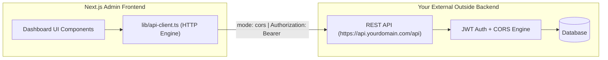

# WorkSphere EMS Admin - Outside Cross-Origin Backend Integration Guide

This repository is a **100% pure Next.js (App Router) frontend**. It contains **no self-hosted or embedded backend code**, database schemas, or server runtimes.

All data fetching is routed to an **external outside backend** (Node/Express, NestJS, Go, Python/FastAPI, Laravel, Spring Boot, etc.) over cross-origin HTTP/HTTPS.

---

## 1. How the Frontend Connects to Your Outside Backend



### Connection Strategy

1. **Direct Cross-Origin (Default)**
   - Set `NEXT_PUBLIC_API_URL=https://api.yourdomain.com/api` (or `http://localhost:5000/api` for local development) in your `.env.local`.
   - The browser sends cross-origin requests directly to your backend.
   - Requires your outside backend to allow CORS for your frontend origin.

2. **Next.js Reverse-Proxy (Zero-CORS Mode)**
   - In [`next.config.ts`](file:///L:/ems-admin/next.config.ts), there is a built-in rewrite for `/api/proxy/:path*`.
   - Set `NEXT_PUBLIC_API_URL=/api/proxy/api` and `BACKEND_ORIGIN=https://api.yourdomain.com`.
   - Next.js acts as a same-origin proxy, completely bypassing browser CORS preflight restrictions.

---

## 2. Frontend Architecture & Integration Points

```
ems-admin/
├── app/                          # Next.js App Router (Pages, layouts, routes)
├── components/                   # UI components (Dashboard, charts, tables)
├── lib/
│   ├── api-client.ts             # Central HTTP fetcher (CORS, Bearer token, auth, diagnostics)
│   └── mock-data.ts              # Resilient fallback mock data if outside API is unreachable
├── types/
│   └── api.ts                    # TypeScript DTO interfaces & enums matching outside API payloads
├── .env.example                  # Pure frontend environment template
└── next.config.ts                # Next.js config with optional reverse-proxy rewrite
```

---

## 3. Outside Backend CORS Configuration Requirements

Your outside backend must return the following CORS response headers when accessed from your frontend domain:

| CORS Header | Required Value / Setting | Purpose |
| :--- | :--- | :--- |
| `Access-Control-Allow-Origin` | `http://localhost:3000` (dev) or `https://admin.yourdomain.com` (prod) | Allows browser to read responses |
| `Access-Control-Allow-Methods` | `GET, POST, PUT, PATCH, DELETE, OPTIONS` | Allows all standard CRUD operations |
| `Access-Control-Allow-Headers` | `Content-Type, Authorization, Accept, X-Requested-With, X-Refresh-Token` | Allows sending JSON bodies and JWT auth |
| `Access-Control-Allow-Credentials` | `true` | Allows credentials if using cookie sessions |
| `Access-Control-Max-Age` | `86400` (24h) | Caches preflight `OPTIONS` requests |

### Quick Example: Node / Express CORS
```javascript
const cors = require("cors");

app.use(cors({
  origin: ["http://localhost:3000", "https://admin.yourdomain.com"],
  credentials: true,
  methods: ["GET", "POST", "PUT", "PATCH", "DELETE", "OPTIONS"],
  allowedHeaders: ["Content-Type", "Authorization", "Accept", "X-Refresh-Token"],
}));
```

### Quick Example: FastAPI (Python) CORS
```python
from fastapi.middleware.cors import CORSMiddleware

app.add_middleware(
    CORSMiddleware,
    allow_origins=["http://localhost:3000", "https://admin.yourdomain.com"],
    allow_credentials=True,
    allow_methods=["*"],
    allow_headers=["*"],
)
```

---

## 4. Expected REST API Contracts

All frontend domain services are configured to communicate with the following routes prefixed by your `NEXT_PUBLIC_API_URL`:

### Response Format
The frontend accepts standard response envelopes:
```json
{
  "success": true,
  "data": { ... },
  "pagination": { "page": 1, "limit": 10, "total": 42 }
}
```
*(Direct raw JSON payloads without the wrapper `{ data: ... }` are also automatically parsed and supported).*

### 1. Authentication (`/auth`)
- `POST /auth/login`
  - Body: `{ email: "...", password: "..." }`
  - Response: `{ success: true, data: { token: "...", refreshToken: "...", user: { id, name, email, role } } }`
- `POST /auth/refresh`
  - Body: `{ refreshToken: "..." }`
  - Response: `{ success: true, data: { token: "...", refreshToken: "..." } }`
- `GET /auth/me`
  - Header: `Authorization: Bearer <token>`
  - Response: `{ success: true, data: { id, name, email, role } }`
- `POST /auth/logout`

### 2. Dashboard Metrics (`/dashboard`)
- `GET /dashboard/metrics`
  - Returns platform totals: `{ totalCompanies, activeCompanies, suspendedCompanies, totalEmployees, totalRevenue, openSupportTickets, ... }`

### 3. Companies (`/companies`)
- `GET /companies?page=1&limit=10&search=&status=`
- `GET /companies/:id`
- `POST /companies`
- `PATCH /companies/:id/status` (Body: `{ status: "ACTIVE" | "SUSPENDED" | "ARCHIVED" }`)
- `DELETE /companies/:id`

### 4. Users (`/users`)
- `GET /users?page=1&limit=10&search=&status=`
- `PATCH /users/:id/status` (Body: `{ status: "ACTIVE" | "SUSPENDED" }`)
- `POST /users`
- `DELETE /users/:id`

### 5. Payments (`/payments`)
- `GET /payments?page=1&limit=10&search=&status=`
- `GET /payments/:id`

### 6. Subscriptions (`/subscriptions`)
- `GET /subscriptions/plans`
- `POST /subscriptions/plans`
- `PUT /subscriptions/plans/:id`

### 7. Support Tickets (`/support`)
- `GET /support/tickets?page=1&limit=10&search=&status=`
- `PATCH /support/tickets/:id/status` (Body: `{ status: "OPEN" | "IN_PROGRESS" | "RESOLVED" | "CLOSED" }`)

### 8. System Logs (`/logs`)
- `GET /logs?page=1&limit=20&search=`

---

## 5. Offline Fallback & Resilience

- If your outside backend is not yet started, offline, or experiencing network latency, all frontend domain services **automatically fall back to the built-in mock data** in [`lib/mock-data.ts`](file:///L:/ems-admin/lib/mock-data.ts).
- As soon as your outside backend responds with HTTP 200, the frontend displays live production data without requiring any UI code modifications.
