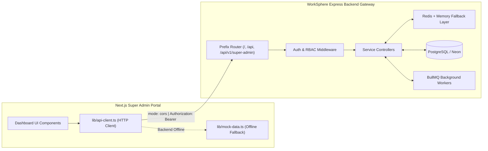

# WorkSphere EMS & Super Admin — Backend Integration & Gap Analysis Guide

> **Document Version:** `2.0.0`  
> **Source Specifications:** [docs/requirements.md](file:///l:/ems-admin/docs/requirements.md) & [docs/requirements-final.md](file:///l:/ems-admin/docs/requirements-final.md)  
> **Backend Reference Catalog:** [docs/api endpoints.md](file:///l:/postgresql-prisma-server/docs/api%20endpoints.md)  
> **Frontend Target:** Next.js (App Router) + TypeScript ([lib/api-client.ts](file:///l:/ems-admin/lib/api-client.ts))  
> **Backend Stack:** Node.js / Express.js, TypeScript, PostgreSQL (Neon Serverless), Prisma ORM, Redis, BullMQ, Socket.IO  

---

## 1. Executive Summary & Integration Architecture

This repository (`ems-admin`) is a **100% pure Next.js (App Router) Super Admin portal**. It communicates with an external Express.js / Node.js backend over HTTP/HTTPS with CORS support, JWT authentication (access & refresh tokens), and server-side RBAC validation.



### Route Mounting Convention
The Express gateway supports three prefix tiers pointing to the same business controllers:
1. **Direct Routes:** `/{service}/*` (e.g. `POST /auth/login`, `GET /companies`)
2. **Standard API Prefix:** `/api/{service}/*` (default in [lib/api-client.ts](file:///l:/ems-admin/lib/api-client.ts): `http://localhost:5000/api`)
3. **Versioned Super Admin:** `/api/v1/super-admin/{service}/*` (enterprise specification matching [requirements-final.md](file:///l:/ems-admin/docs/requirements-final.md))

---

## 2. Backend Audit Results & Gap Analysis

A rigorous comparison between the requirements specifications ([docs/requirements.md](file:///l:/ems-admin/docs/requirements.md), [docs/requirements-final.md](file:///l:/ems-admin/docs/requirements-final.md)) and the current Express backend implementation ([docs/api endpoints.md](file:///l:/ems-admin/docs/api%20endpoints.md)) reveals significant backend gaps categorized below:

### 2.1 Backend Implementation Status Matrix

| Module / Route Group | Implemented in Backend | Status & Implementation Details | Priority |
| :--- | :---: | :--- | :---: |
| **Auth: Standard Login & Refresh** | ✅ Yes | Fully implemented with JWT access & refresh token rotation | P0 |
| **Auth: Two-Factor Authentication (2FA)** | ✅ Yes | Implemented `POST /auth/verify-2fa` TOTP challenge-gated verification | P0 |
| **Auth: Password Recovery** | ✅ Yes | Implemented `POST /auth/forgot-password` & `POST /auth/reset-password` | P0 |
| **Auth: Registration Governance** | ✅ Yes | Enforced **AC-02**: Self-registration disabled; operators invited via `/admin-users` | P0 |
| **Tenant Companies: List & View** | ✅ Yes | Paginated directory, search, status filters, and company deep metadata | P0 |
| **Tenant Companies: Suspension** | ✅ Yes | Enforces mandatory reason and logs audit event (**AC-04**, **AC-05**) | P0 |
| **Tenant Companies: Edit Metadata** | ✅ Yes | Implemented `PATCH /companies/:id` (name, slug, ownerEmail, metadata) | P1 |
| **Tenant Companies: Reactivation** | ✅ Yes | Implemented `POST /companies/:id/reactivate` (restores `ACTIVE`, clears reason) | P1 |
| **Tenant Companies: KYB Verification** | ✅ Yes | Implemented `POST /companies/:id/verify` & `POST /companies/:id/reject` | P1 |
| **Plans & Subscriptions: Read & Switch** | ✅ Yes | List plans, list subscriptions, change plan, extend trial | P0 |
| **Plans & Subscriptions: Plan CRUD** | ✅ Yes | Implemented `POST /plans` (create) and `PATCH /plans/:id` (edit/versioning) | P1 |
| **Subscriptions: Cancellation** | ✅ Yes | Implemented `POST /subscriptions/:id/cancel` with audit logging | P1 |
| **Payments: Ledger & Refunds** | ✅ Yes | List payments, view receipt, process full/partial refund | P0 |
| **Payments: Reconciliation** | ✅ Yes | Implemented `POST /payments/:id/reconcile` (Stripe/SSLCommerz/bKash sync) | P1 |
| **Coupons & Promotions** | ✅ Yes | Implemented `GET /promotions`, `GET /promotions/coupons`, `POST /promotions` | P2 |
| **Support Desk: Tickets & Replies** | ✅ Yes | List tickets, get thread, public replies, internal staff notes, status | P1 |
| **Support Desk: Ticket Assignment** | ✅ Yes | Implemented `POST /tickets/:id/assign` (reassigns ticket operator) | P1 |
| **Platform Announcements** | ✅ Yes | Implemented `GET /announcements`, `POST /announcements`, `PATCH`, `DELETE` | P1 |
| **Platform Operators (`/admin-users`)** | ✅ Yes | Full operator CRUD: `GET /admin-users`, `POST`, `PATCH /:id`, `DELETE /:id` | P0 |
| **Roles & Permissions (`/roles`)** | ✅ Yes | Full RBAC CRUD: `GET /roles`, `POST`, `PATCH /:id`, `GET /roles/permissions` | P0 |
| **Audit Logs: Query** | ✅ Yes | Query audit events with search, resourceType, and action filters | P0 |
| **Audit Logs: Export** | ✅ Yes | Implemented `GET /logs/export` (CSV and JSON compliance reports) | P1 |
| **System Health: Basic Heartbeat** | ✅ Yes | Single-node heartbeat `GET /health` with Redis status & latency | P0 |
| **System Health: Multi-Service Nodes** | ✅ Yes | Implemented `GET /health/services` & `GET /system-health` (Postgres, Redis, BullMQ, S3) | P1 |
| **Background Jobs & Webhook Observability** | ✅ Yes | Implemented BullMQ queue monitor `GET /jobs`, `POST /jobs/:id/retry`, `GET /webhooks` | P1 |
| **Platform Settings & Configuration** | ✅ Yes | Implemented `GET /settings` and `PATCH /settings` (with secret masking) | P2 |
| **Platform Security Policies** | ✅ Yes | Implemented `GET /security-settings`, `GET /security-policy`, `PATCH /security-policy` | P2 |
| **Integrations Diagnostic** | ✅ Yes | Implemented `GET /integrations` and `POST /integrations/:id/test` | P2 |
| **Session Security Management** | ✅ Yes | Implemented `GET /auth/sessions` and `DELETE /auth/sessions/:id` | P1 |

---

## 3. Step-by-Step Backend Implementation Instructions

Follow this prioritized implementation plan to bring the backend into 100% compliance with the specifications.

### Phase 1: Critical P0 Blockers (Authentication, Governance & Admin Users)

#### 1.1 Complete 2FA TOTP Verification
- **Route:** `POST /api/v1/super-admin/auth/verify-2fa` (alias: `POST /auth/verify-2fa`)
- **Access:** Public (Challenge-gated via temporary token)
- **Controller Logic:**
  1. Receive `{ tempToken: string, code: string }`.
  2. Verify signature of `tempToken` and extract `adminId`.
  3. Load admin's encrypted `mfaSecret` from database (`PlatformAdmin`).
  4. Verify the 6-digit TOTP token using `otplib` or `speakeasy`.
  5. Upon success, issue 1-hour access token, 7-day refresh token, record session in `PlatformAdminSession`, and log an `ADMIN_LOGIN_2FA` audit entry.
- **Error Responses:** `401 Unauthorized` for expired temp token or invalid 6-digit code.

#### 1.2 Implement Password Reset Flow
- **Route 1:** `POST /api/v1/super-admin/auth/forgot-password` (alias: `POST /auth/forgot-password`)
  - **Body:** `{ email: string }`
  - **Logic:** Rate-limited (max 5 req/15min). If admin exists, generate a cryptographically random, 1-hour expiration token hashed with SHA-256. Dispatch password reset email. Always return `{ success: true, message: "If an account exists, instructions have been sent." }` to prevent user enumeration.
- **Route 2:** `POST /api/v1/super-admin/auth/reset-password` (alias: `POST /auth/reset-password`)
  - **Body:** `{ token: string, password: string }`
  - **Logic:** Validate token against hash and expiry. Hash new password with bcrypt (cost factor >= 12) or Argon2id. Revoke all active sessions (`revokedAt = new Date()`). Write `PASSWORD_RESET` audit log.

#### 1.3 Implement Platform Admin Operators (`/admin-users`)
- **Controller:** `src/services/admin-users/admin-users.controller.ts`
- **Endpoints:**
  - `GET /api/v1/super-admin/admin-users` (paginated list of platform operators, roles, 2FA status, last login IP, status).
  - `POST /api/v1/super-admin/admin-users`: Body `{ name, email, roleId }`. Sends invitation email with set-password link.
  - `PATCH /api/v1/super-admin/admin-users/:id`: Body `{ roleId?: string, status?: "ACTIVE" | "SUSPENDED" }`. Prevents self-suspension or revoking root Super Admin permissions.

#### 1.4 Implement Roles & Permissions (`/roles`)
- **Controller:** `src/services/roles/roles.controller.ts`
- **Endpoints:**
  - `GET /api/v1/super-admin/roles`: Returns all system and custom platform roles with attached permission keys.
  - `POST /api/v1/super-admin/roles`: Body `{ name, slug, description, permissions: string[] }`.
  - `PATCH /api/v1/super-admin/roles/:id`: Body `{ name?: string, description?: string, permissions?: string[] }`. Protects system roles (`isSystem: true`) from deletion.

---

### Phase 2: P1 High-Priority Operations

#### 2.1 Multi-Service Health Telemetry (`/health/services`)
- **Route:** `GET /api/v1/super-admin/system-health` (alias: `GET /health/services`)
- **Access:** Authenticated (`Bearer <token>`)
- **Expected Payload matching [types/api.ts](file:///l:/ems-admin/types/api.ts):**
  ```json
  {
    "success": true,
    "data": [
      {
        "id": "srv-db",
        "name": "PostgreSQL Primary (Neon)",
        "type": "DATABASE",
        "status": "OPERATIONAL",
        "latencyMs": 14,
        "uptimePercent": 99.99,
        "lastCheckedAt": "2026-10-17T13:00:00.000Z",
        "details": "Connection pool: 18/20 active"
      },
      {
        "id": "srv-redis",
        "name": "Redis Distributed Cache",
        "type": "CACHE",
        "status": "OPERATIONAL",
        "latencyMs": 2,
        "uptimePercent": 100.0,
        "lastCheckedAt": "2026-10-17T13:00:00.000Z",
        "details": "Engine: redis (0 memory fallback keys)"
      },
      {
        "id": "srv-workers",
        "name": "BullMQ Worker Cluster",
        "type": "QUEUE",
        "status": "OPERATIONAL",
        "latencyMs": 5,
        "uptimePercent": 99.95,
        "lastCheckedAt": "2026-10-17T13:00:00.000Z",
        "details": "Waiting: 3, Active: 2, Failed: 0"
      }
    ]
  }
  ```

#### 2.2 Background Workers & Webhooks Telemetry (`/jobs`, `/webhooks`)
- **Routes:**
  - `GET /api/v1/super-admin/jobs`: Summarizes queue metrics across BullMQ workers (emails, billing recurring charges, reports).
  - `POST /api/v1/super-admin/jobs/:id/retry`: Re-enqueues a failed BullMQ job by ID.
  - `GET /api/v1/super-admin/webhooks`: Paginated list of outbound webhook delivery attempts to tenant URLs (HTTP status, attempts, error body).

#### 2.3 Platform Announcements (`/announcements`)
- **Routes:**
  - `GET /api/v1/super-admin/announcements`: List active and scheduled system-wide banners.
  - `POST /api/v1/super-admin/announcements`: Body `{ title, message, priority, targetScope, startsAt, expiresAt }`. Emits real-time notification to active tenant Socket.IO clients.

#### 2.4 Tenant Lifecycle Completeness
- `PATCH /api/v1/super-admin/companies/:id`: Updates name, owner email, phone, website.
- `POST /api/v1/super-admin/companies/:id/reactivate`: Restores eligible suspended access with reason and audit trail.
- `POST /api/v1/super-admin/companies/:id/reject`: Rejects unverified company KYB submission with mandatory reason.

---

### Phase 3: P2 Secondary Enhancements

#### 3.1 Promotional Coupons Engine (`/promotions`)
- **Routes:**
  - `GET /api/v1/super-admin/promotions` (alias: `GET /promotions/coupons`)
  - `POST /api/v1/super-admin/promotions` (create promotional discount code)
  - Fields: `code`, `discountType` (`PERCENTAGE` / `FIXED`), `discountValue`, `maxUses`, `usedCount`, `expiresAt`, `isActive`.

#### 3.2 Platform Settings & Security Policies
- `GET /api/v1/super-admin/settings` & `PATCH /api/v1/super-admin/settings`: Manage `platformName`, `supportEmail`, `defaultCurrency`, `maintenanceMode`.
- `GET /api/v1/super-admin/security-settings` & `PATCH /api/v1/super-admin/security-policy`: Manage session idle timeout (e.g. 15 minutes), password complexity rules, mandatory 2FA enforcement for administrative staff.
- `GET /api/v1/super-admin/integrations` & `POST /api/v1/super-admin/integrations/:id/test`: Ping third-party APIs (Stripe, SSLCommerz, bKash, S3, SendGrid) and report status without exposing API keys.

---

## 4. Prisma ORM Database Schema Requirements

The active database schema models implemented in `prisma/schema.prisma`:

```prisma
// Platform Operator
model PlatformAdmin {
  id          String       @id @default(uuid())
  email       String       @unique
  password    String
  name        String
  avatarUrl   String?      @map("avatar_url")
  roleId      String       @map("role_id")
  role        PlatformRole @relation(fields: [roleId], references: [id])
  status      AdminStatus  @default(ACTIVE)
  mfaSecret   String?      @map("mfa_secret")
  mfaEnabled  Boolean      @default(false) @map("mfa_enabled")
  lastLoginAt DateTime?    @map("last_login_at")
  lastLoginIp String?      @map("last_login_ip")
  createdAt   DateTime     @default(now()) @map("created_at")
  updatedAt   DateTime     @updatedAt @map("updated_at")

  sessions        PlatformAdminSession[]
  assignedTickets SupportTicket[]
  auditLogs       AuditLog[]

  @@index([email])
  @@index([roleId])
  @@map("platform_admins")
}

// Active Sessions
model PlatformAdminSession {
  id               String        @id @default(uuid())
  adminId          String        @map("admin_id")
  admin            PlatformAdmin @relation(fields: [adminId], references: [id], onDelete: Cascade)
  refreshTokenHash String        @map("refresh_token_hash")
  userAgent        String?       @map("user_agent")
  ipAddress        String?       @map("ip_address")
  expiresAt        DateTime      @map("expires_at")
  revokedAt        DateTime?     @map("revoked_at")
  createdAt        DateTime      @default(now()) @map("created_at")

  @@index([adminId])
  @@map("platform_admin_sessions")
}

// Platform RBAC Roles
model PlatformRole {
  id          String   @id @default(uuid())
  name        String
  slug        String   @unique
  description String?
  isSystem    Boolean  @default(false) @map("is_system")
  createdAt   DateTime @default(now()) @map("created_at")
  updatedAt   DateTime @updatedAt @map("updated_at")

  admins      PlatformAdmin[]
  permissions PlatformRolePermission[]

  @@map("platform_roles")
}

model PlatformPermission {
  key         String   @id
  description String
  category    String
  createdAt   DateTime @default(now()) @map("created_at")

  roles PlatformRolePermission[]

  @@map("platform_permissions")
}

model PlatformRolePermission {
  roleId        String             @map("role_id")
  permissionKey String             @map("permission_key")
  role          PlatformRole       @relation(fields: [roleId], references: [id], onDelete: Cascade)
  permission    PlatformPermission @relation(fields: [permissionKey], references: [key], onDelete: Cascade)

  @@id([roleId, permissionKey])
  @@map("platform_role_permissions")
}

// Promotional Coupons
model Promotion {
  id             String       @id @default(uuid())
  code           String       @unique
  description    String?
  discountType   DiscountType @default(PERCENTAGE) @map("discount_type")
  discountValue  Int          @map("discount_value")
  validFrom      DateTime     @default(now()) @map("valid_from")
  validUntil     DateTime?    @map("valid_until")
  maxRedemptions Int?         @map("max_redemptions")
  timesRedeemed  Int          @default(0) @map("times_redeemed")
  isActive       Boolean      @default(true) @map("is_active")
  createdAt      DateTime     @default(now()) @map("created_at")
  updatedAt      DateTime     @updatedAt @map("updated_at")

  @@map("promotions")
}

// System Announcements
model Announcement {
  id             String           @id @default(uuid())
  title          String
  content        String
  type           AnnouncementType @default(INFO)
  targetAudience String           @default("ALL") @map("target_audience")
  isPublished    Boolean          @default(false) @map("is_published")
  publishedAt    DateTime?        @map("published_at")
  expiresAt      DateTime?        @map("expires_at")
  createdAt      DateTime         @default(now()) @map("created_at")
  updatedAt      DateTime         @updatedAt @map("updated_at")

  @@map("announcements")
}

// Global System Settings
model SystemSetting {
  key         String   @id
  value       Json
  isSecret    Boolean  @default(false) @map("is_secret")
  description String?
  updatedBy   String?  @map("updated_by")
  updatedAt   DateTime @updatedAt @map("updated_at")

  @@map("system_settings")
}
```

---

## 5. Security & Compliance Implementation Rules

### 5.1 Financial Units Standardization (Cents Standard)
- All monetary amounts in database tables and JSON responses must be represented as **integer cents (minor currency units)**:
  - Database: `amountCents: Int` (e.g. `$299.00` = `29900`).
  - Response DTO: Provide `amountCents: 29900` and formatted helper `amount: 299.00` or `amountFormatted: "$299.00"`.
  - Eliminates the 100x calculation discrepancy between `/payments` list and `/payments/:id` details.

### 5.2 Webhook Idempotency (AC-08 & AC-09)
- All incoming payment webhooks from Stripe, SSLCommerz, and bKash must store incoming `event_id` or `idempotency_key`.
- If an event is re-delivered, return `200 OK` immediately without re-crediting or duplicating financial ledger entries.

### 5.3 Audit Log Immutability (AC-10 & AC-11)
- The PostgreSQL database user for the application service must have only `INSERT` and `SELECT` privileges on the `audit_logs` table (no `UPDATE` or `DELETE`).
- Before inserting audit records, redact sensitive keys in the `changes` JSON payload (`password`, `passwordHash`, `mfaSecret`, `token`, `cardNumber`, `cvv`).

### 5.4 Step-Up Re-Authentication
- Before executing high-impact actions (payment refunds exceeding threshold, security policy modification, integration secrets rotation), require operator password confirmation or 2FA challenge verification.

---

## 6. Frontend Offline Resilience & Developer Testing

### Frontend Mock Fallback
- If the Express backend is not running, offline, or returns HTTP network errors, the Next.js frontend automatically falls back to sample records in [lib/mock-data.ts](file:///l:/ems-admin/lib/mock-data.ts).
- Demo Super Admin account credentials when offline:
  - **Email:** `admin@worksphere.com`
  - **Password:** `Admin360`

### Local Environment Configuration
In `ems-admin/.env.local`:
```env
# Point directly to outside Express backend
NEXT_PUBLIC_API_URL=http://localhost:5000/api

# App URL
NEXT_PUBLIC_APP_URL=http://localhost:3000
```

### Outside Backend Health Verification
To test connectivity from the terminal:
```bash
# Verify basic heartbeat & Redis health
curl -s http://localhost:5000/health

# Verify API root explorer
curl -s -H "Accept: application/json" http://localhost:5000/api

# Test admin login
curl -s -X POST http://localhost:5000/api/auth/login \
  -H "Content-Type: application/json" \
  -d '{"email":"admin@worksphere.com","password":"YourPassword123!"}'
```
