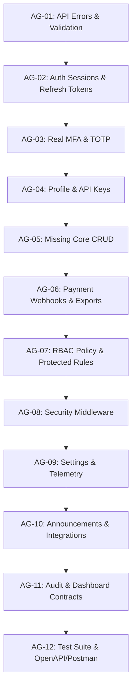

# Super Admin Platform — Backend Implementation Steps & Task Backlog

> **Source Specification:** [docs/improvements.md](file:///l:/postgresql-prisma-server/docs/improvements.md)  
> **Target:** 12 Controller Modules | 81 Endpoints | Express + Prisma + PostgreSQL + Redis  
> **Audited by:** OpenClaw Project Coordinator  
> **Executor:** Antigravity  

---

## 1. Executive Summary & Current State

The codebase currently has a functional Express + Prisma foundation (10 service modules, JWT authentication, Redis-backed cache layer, and seeded roles). However, several key areas diverge from the target specification in [improvements.md](file:///l:/postgresql-prisma-server/docs/improvements.md):
- Error envelopes and request validation are not standardized across all endpoints.
- Auth sessions and refresh token rotation lack durable tracking and revocation safeguards.
- 2FA is currently a placeholder without authentic TOTP verification.
- Several telemetry and webhook operations currently return static or mock responses.
- Missing endpoints across Profile, Companies, Subscriptions, Payments, and Support.

### Endpoint Coverage Matrix

| Module | Spec Endpoints | Current Status | Notes |
|---|:---:|---|---|
| **1. Authentication** | 7 | 6 present, 1 missing | Register absent; token rotation/session invalidation incomplete. |
| **2. Profile, Sessions, API Keys** | 12 | 1 matches, 3 partial, 8 missing | `/auth/me` exists; profile updates, TOTP 2FA, API keys missing. |
| **3. Companies & KYB** | 7 | 6 partial, 1 missing | Missing trial extension; company dossier needs tenant user model. |
| **4. Subscriptions & Plans** | 7 | 6 partial, 1 missing | Missing `GET /subscriptions/:id`. |
| **5. Payments** | 5 | 3 partial, 2 missing | Missing CSV/JSON export and verified gateway webhooks. |
| **6. Support Tickets** | 6 | 5 partial, 1 missing | Missing `POST /support/tickets`. |
| **7. Roles & Admin Users** | 8 | Contract defects | Role update uses `PATCH` instead of `PUT`; system role deletion needs `403`. |
| **8. Settings & Security** | 6 | 4 partial, 2 missing | Security policy PATCH path mismatch; session revocation missing. |
| **9. Health, Jobs, Webhooks** | 9 | 5 partial, 4 missing | Services/jobs/webhooks use mocks; missing retry/purge/resend actions. |
| **10. Announcements, Coupons, Integrations** | 10 | 5 partial, 5 missing | Path mismatches on coupons; integration config/disconnect absent. |
| **11. Audit Logs** | 2 | Implemented | Needs refined query filters and append-only immutability. |
| **12. Dashboard** | 2 | Implemented | Metrics and activity stream exist. |
| **Total** | **81** | | |

---

## 2. Key Architecture & Security Gaps

1. **Error Envelopes & Validation**: Error envelopes must consistently follow `{ success: false, message: string, errors?: Record<string, string[]> }` for all 400, 404, 409, and 500 responses.
2. **Refresh Token Lifecycle**: Refresh tokens must be stored as cryptographically secure hashes with associated session identifiers, rotated on each refresh, and individually revocable.
3. **MFA (TOTP)**: Replace the 6-digit regex check with RFC 6238 TOTP verification (`otplib`), emit short-lived challenge tokens on login, and provide QR/secret setup.
4. **RBAC Alignment**: Synchronize the 16 documented permission flags with `prisma/seed.ts` and routes. Enforce `403 Forbidden` on protected system roles and root super admin deletion.
5. **Operational Security**: Add rate-limiting, IP allowlist, and maintenance-mode middlewares.

---

## 3. Phased Task Sequence

---

### Phase 1: Core Foundation & Contract Stability

- [x] **AG-01 — Normalize API Errors and Validation Boundary**
  - **Target Files:** `src/lib/response.ts`, `src/app.ts`, `src/middleware/validate.middleware.ts`
  - **Specification:** Section 2, Section 8, Section 9 (Response / Error helpers).
  - **Requirements:**
    - Standardize all error responses to `{ success: false, message: string, errors?: Record<string, string[]> }`.
    - Ensure malformed JSON, 404 routes, and unhandled errors return the identical envelope.
    - Create a reusable Zod/schema validation middleware returning HTTP 400 with field-keyed error details.
  - **Acceptance Criteria:**
    - Test requests with invalid JSON, missing body fields, and non-existent routes return the exact specification envelope.

---

### Phase 2: Authentication, Sessions & Credentials

- [x] **AG-02 — Repair Authentication Session & Refresh-Token Lifecycle**
  - **Target Files:** `prisma/schema.prisma`, `src/lib/jwt.ts`, `src/services/auth/auth.controller.ts`, `src/services/auth/auth.routes.ts`
  - **Specification:** Section 3.1 & Section 5 (Rules 6–7).
  - **Requirements:**
    - Create a durable `AdminSession` model in Prisma with `sessionId`, `hashedRefreshToken`, `ipAddress`, `userAgent`, `expiresAt`, `revokedAt`.
    - Rotate refresh tokens upon usage and invalidate the previous token.
    - Support logging out current session vs. revoking all other sessions.
  - **Acceptance Criteria:**
    - Old/reused refresh tokens are rejected.
    - Session revocation prevents token renewal immediately.

- [x] **AG-03 — Implement Real MFA (TOTP) & Profile MFA Endpoints**
  - **Target Files:** `src/services/profile/profile.routes.ts`, `src/services/profile/profile.controller.ts`, `src/lib/totp.ts`, `src/services/auth/auth.controller.ts`
  - **Specification:** Section 3.1, Section 3.2, Section 5 (Rule 5).
  - **Requirements:**
    - Implement `/profile/2fa/setup` (generates secret and QR code URI).
    - Implement `/profile/2fa/enable` (verifies TOTP before activating).
    - Implement `/profile/2fa/disable` (requires password confirmation).
    - Login with 2FA enabled returns a temporary, restricted MFA challenge token.
    - Verify `/auth/verify-2fa` checks authentic TOTP against `mfaSecret`.
  - **Acceptance Criteria:**
    - Invalid or expired TOTP codes are rejected.
    - Challenge tokens cannot be used to access protected endpoints.

- [x] **AG-04 — Add Profile Update and API-Key Management**
  - **Target Files:** `prisma/schema.prisma`, `src/services/profile/*`, `src/routes/index.ts`
  - **Specification:** Section 3.2 (Endpoints 2–12), Section 5 (Rule 8).
  - **Requirements:**
    - Profile update (`PATCH /profile`) and password change (`PATCH /profile/password`).
    - API Key model with SHA-256 hashed secret, prefixes, permissions/scopes, and expiry.
    - Raw API keys displayed once upon creation and never returned in list queries.
    - Profile session management (`GET /profile/sessions`, `DELETE /profile/sessions/:id`, `DELETE /profile/sessions`).
  - **Acceptance Criteria:**
    - API keys cannot be viewed after initial generation.
    - Terminated sessions cannot be used for further requests.

---

### Phase 3: Core Domain Endpoints Completion

- [x] **AG-05 — Implement High-Confidence Missing CRUD Endpoints**
  - **Target Files:** `src/services/companies/*`, `src/services/subscriptions/*`, `src/services/payments/*`, `src/services/support/*`
  - **Specification:** Sections 3.3, 3.4, 3.5, 3.6.
  - **Requirements:**
    - `POST /companies/:id/extend-trial` (validates days, logs audit reason).
    - `GET /subscriptions/:id` (returns detailed subscription with tenant and plan data).
    - `POST /support/tickets` (allows admin creation of internal/support tickets).
    - Add required conflict handling (`409 Conflict`) for invalid entity status transitions.
  - **Acceptance Criteria:**
    - All endpoints adhere to `{ success: true, data: { ... } }`.
    - Invalid status transitions (e.g. suspending an already suspended company) return 409.

- [ ] **AG-06 — Implement Payment Webhooks & Safe Data Exports**
  - **Target Files:** `src/services/payments/*`, `src/lib/webhook-verifier.ts`, `prisma/schema.prisma`
  - **Specification:** Section 3.5, Section 5 (Rule 10).
  - **Requirements:**
    - Add `GET /payments/export` supporting CSV and JSON formats based on filters.
    - Add public, signature-verified webhook endpoints: `POST /payments/webhook/:gateway` (bKash, SSLCOMMERZ, Stripe).
    - Implement webhook idempotency table to prevent duplicate transaction credits.
  - **Acceptance Criteria:**
    - Invalid webhook signatures return `401`/`403`.
    - Duplicate webhook payloads do not re-trigger payment events.

---

### Phase 4: Governance, RBAC & Security Middleware

- [ ] **AG-07 — Correct RBAC Policy Matrix & Protected-Resource Rules**
  - **Target Files:** `prisma/seed.ts`, `src/middleware/auth.middleware.ts`, `src/services/roles/*`, `src/services/admin-users/*`
  - **Specification:** Section 3.7, Section 5 (Rules 1–4), Section 9.
  - **Requirements:**
    - Consolidate to the 16 documented permission flags.
    - Change Role Update endpoint to `PUT /roles/:id`.
    - Return `403 Forbidden` when attempting to delete or edit system-protected roles (`SUPER_ADMIN`).
    - Strictly forbid deletion of root super admin (`isRoot: true`).
    - Ensure read endpoints enforce corresponding `.view` permissions.
  - **Acceptance Criteria:**
    - Tests verify root bypass, operator permissions, and rejection of protected role modification.

- [ ] **AG-08 — Enforce Operational Security Middleware**
  - **Target Files:** `src/middleware/rate-limit.middleware.ts`, `src/middleware/ip-filter.middleware.ts`, `src/middleware/maintenance.middleware.ts`, `src/app.ts`
  - **Specification:** Section 5 (Rules 11–15).
  - **Requirements:**
    - Rate-limit sensitive endpoints (Login: 5 attempts/15min, Forgot Password: 3 attempts/hr, 2FA: 5 attempts/10min).
    - IP allowlist middleware checking `x-forwarded-for` against security settings.
    - Maintenance mode middleware returning `503 Service Unavailable` with retry-after header.
    - Automatic mutation audit logging capturing actor ID, IP, user-agent, route, and status code.
  - **Acceptance Criteria:**
    - Exceeding login attempts returns `429 Too Many Requests`.
    - Disallowed IPs receive `403 Forbidden`.

---

### Phase 5: Operations, Integrations & Polish

- [ ] **AG-09 — Complete Settings, Infrastructure Telemetry & Webhook Operations**
  - **Target Files:** `src/services/settings/*`, `src/routes/index.ts`
  - **Specification:** Sections 3.8 & 3.9.
  - **Requirements:**
    - Mount `GET /security-settings` and `PATCH /security-settings`.
    - Implement `POST /security-settings/revoke-all-sessions` and `POST /security-settings/reset-defaults`.
    - Secure `GET /health/services` behind authentication.
    - Replace mock telemetry with live BullMQ queue stats, Redis ping, and database health.
    - Implement dead-letter queue job retry (`POST /jobs/:id/retry`) and purge.
  - **Acceptance Criteria:**
    - Telemetry accurately reflects Redis, Database, and Queue health states.

- [ ] **AG-10 — Complete Announcements, Coupons & Integration Providers**
  - **Target Files:** `src/services/support/*`, `src/services/payments/*`, `src/services/settings/*`
  - **Specification:** Section 3.10, Section 5 (Rule 9).
  - **Requirements:**
    - Dedicated coupon endpoints: `GET /promotions/coupons`, `POST /promotions/coupons`, `DELETE /promotions/coupons/:id`.
    - Announcement status toggle: `PATCH /announcements/:id/status`.
    - Integration provider management: `GET /integrations`, `POST /integrations/:id/test`, `PUT /integrations/:id/config`, `POST /integrations/:id/disconnect`.
    - Encrypt integration API keys and secrets at rest using AES-256-GCM.
  - **Acceptance Criteria:**
    - Stored credentials are encrypted in DB and redacted in GET responses.

- [ ] **AG-11 — Complete Audit Log & Dashboard Contracts**
  - **Target Files:** `src/services/audit/*`, `src/services/dashboard/*`
  - **Specification:** Sections 3.11 & 3.12.
  - **Requirements:**
    - Support audit filters: `actor`, `action`, `resource`, `status`, `from`, `to`.
    - Support streaming or pagination export for audit logs.
    - Ensure audit log table is append-only (no update or delete endpoints exposed).
    - Standardize dashboard metrics (MRR, active tenants, churn rate, pending KYB, open tickets).
  - **Acceptance Criteria:**
    - Filter combinations yield correct subsets.
    - Dashboard KPIs calculate accurate aggregations from active database records.

---

### Phase 6: Automated Verification & Documentation

- [ ] **AG-12 — Establish Automated API Verification Suite & Documentation**
  - **Target Files:** `package.json`, `tests/*`, `docs/openapi.yaml` or Postman collection
  - **Specification:** Section 9 (API tests and Postman/OpenAPI collection).
  - **Requirements:**
    - Configure an automated test suite (`npm test` via Jest/Vitest/Supertest).
    - Write integration tests covering auth, RBAC permissions, and critical CRUD paths.
    - Generate an OpenAPI 3.0 / Postman specification covering all 81 endpoints.
  - **Acceptance Criteria:**
    - `npm test` runs and passes completely against a test database.
    - Full endpoint count matches 81 endpoints across all 12 modules.
